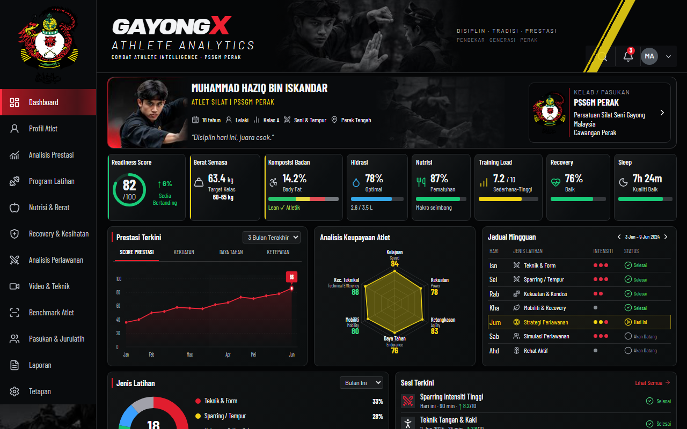

  

  <h1>GAYONGX Athlete Analytics</h1>
  
<strong>Responsive Silat Performance Analytics & Athlete Conditioning Dashboard</strong>

  

    
    
    
    
  

  

    
    
    
    
    
    
    
  

---

## Overview

- **Functionality**: Specialized silat sports-science performance cockpit featuring typed synthetic benchmarks, interactive radar charts, biometric conditioning tracking, and combat video review annotations.
- **Aesthetic Value**: High-contrast athletic dashboard aesthetic blending dense numerical readouts with responsive SVG radar graphs, modular card surfaces, and mobile safe-area adaptations.
- **Business Value**: Equips martial arts coaches with empirical training load analytics, pinpointing reaction velocity and aerobic endurance deficits ahead of tournament selections.

Screenshot-driven React + TypeScript frontend demo. All athlete profiles, measurements, competition records, and benchmarks are synthetic; this is an exploratory athletic performance dashboard prototype.

---

## Platform Scope & Architecture

No external database or server runtime dependencies are required. Settings persist locally, and training/profile/nutrition edits are reactive across the mounted application screen. Reports export directly to local CSV. Video review screens illustrate tactical frame annotations.

- **Hash-Routing Architecture**: All twelve routes use hash URLs (e.g. `/#/latihan`) to ensure seamless refresh tolerance on static edge hosts.
- **Component Breakdown**:
  - `src/App.tsx`: Responsive application shell and hash routing provider.
  - `src/components/layout`: Brand header, official PSSGM emblem sidebar, and athlete hero strip.
  - `src/components/dashboard`, `charts`: High-density desktop panels and interactive SVG radar/trend charts.
  - `src/components/mobile`: Dedicated mobile dashboard, training composition, and safe-area touch navigation.
  - `src/components/screens`: Full demo modules sharing reusable `ScreenPrimitives`.
  - `src/data`: Typed synthetic data models with explicit benchmark provenance.
  - `src/index.css`: Shared design tokens and viewport-specific composition.

---

## Reference and Assets

The supplied references are `athlete-desktop.jpg` and `athlete-mobile.jpg`, archived under `public/images/`. The app reconstructs the complete screen flow with responsive SVG charts and modular cards without artificial device frames.

`public/assets/pssgm-logo.png` is an unchanged copy of the official PSSGM emblem. Photographic demo assets are presentation crops extracted from the supplied references, strictly for demonstration purposes.

---

## Continuous Integration & Quality

Platform stability is maintained through automated continuous integration workflows:
- **Type Checking**: Strict TypeScript validation across all modules.
- **Automated Verification**: GitHub Actions workflow (`.github/workflows/ci.yml`) validates linting and production bundling on every push to `main`.
- **Browser QA**: Automated Playwright test coverage verifying route health, interaction stability, and visual layout fidelity.

---

## License

Copyright (c) 2026 Muhammad Syahmi ([syahmiaof](https://syahmiaof.my)). All rights reserved.  
Proprietary source code created solely for demonstration and portfolio showcase purposes.
